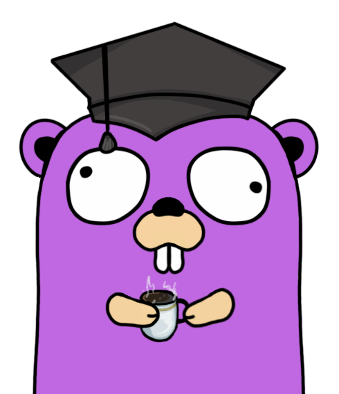

[](https://github.com/dkorunic/e-dnevnik-bot/blob/main/LICENSE)
[](https://github.com/dkorunic/e-dnevnik-bot/releases/latest)
[](https://github.com/dkorunic/e-dnevnik-bot/actions/workflows/goreleaser.yml)



## Table of Contents

- [About](#about)
- [Privacy policy](#privacy-policy)
- [Requirements](#requirements)
- [Installation](#installation)
  - [Usage](#usage)
  - [Environment variables](#environment-variables)
  - [Files](#files)
  - [Alert behaviour](#alert-behaviour)
- [Configuration](#configuration)
  - [User](#user-configuration) · [Telegram](#telegram-configuration) · [Discord](#discord-configuration) · [Slack](#slack-configuration) · [Mail/SMTP](#mailsmtp-configuration) · [WhatsApp](#whatsapp-configuration) · [Google Calendar](#google-calendar-configuration) · [CalDAV](#caldav-configuration) · [Webhook](#webhook-configuration) · [Weekly digest](#weekly-exam-digest)
- [HOWTO](#howto)
  - [Systemd](#integration-with-systemd)
  - [Docker](#running-as-a-docker-container)
  - [Docker Compose](#running-using-docker-compose)
  - [Authorizing Google Calendar on a desktop](#authorizing-google-calendar-on-a-desktop)
  - [GitHub Actions](#running-in-github-actions)
- [Star History](#star-history)

## About

e-Dnevnik bot is a self-hosted service that polls the [CARNet e-Dnevnik](https://ocjene.skole.hr/) portal for one or more AAI/AOSI users (skole.hr) and sends an alert for every new event, as a one-shot run or a daemon.

| Event | Notes |
|---|---|
| Grades | Includes the subject's average once it has two or more numeric grades |
| Exams | Newly scheduled exams, plus a [weekly digest](#weekly-exam-digest) |
| Final grades | End-of-year grades per subject |
| National exams | Results |
| Reading lists | Opt-in: `--readinglist` |

Alerts go to every enabled backend:

- [Telegram](https://telegram.org/), [Discord](https://discord.com/), [Slack](https://slack.com/), [WhatsApp](https://www.whatsapp.com/), e-mail (SMTP)
- Any HTTP webhook: [ntfy](https://ntfy.sh/), [Gotify](https://gotify.net/), [Home Assistant](https://www.home-assistant.io/), n8n, …
- [Google Calendar](https://calendar.google.com/) and any [CalDAV](https://en.wikipedia.org/wiki/CalDAV) calendar (Nextcloud, Radicale, Baïkal, Fastmail, iCloud, …): exams only

Credentials stay on the host running the bot.

> [!IMPORTANT]
> Since May 2023 CARNet's firewall blocks non-Croatian IP addresses, including popular cloud and VPS providers (Oracle Cloud, Contabo, AWS, Azure) and GitHub-hosted runners. The bot must run on a host in Croatia.

## Privacy policy

The bot uses Google's Application Programming Interface (API) Services to add school exam events to your Google Calendar.

Use of information received from Google APIs complies with the [Google API Services User Data Policy](https://developers.google.com/terms/api-services-user-data-policy), including the [Limited Use requirements](https://support.google.com/cloud/answer/9110914#explain-types&zippy=%2Ccould-you-explain-the-limited-use-requirements-from-the-google-api-services-user-data-policy).

Your Google information is used solely to provide the user-facing calendar integration feature. No data is collected, stored remotely, or tracked in any way. All authorization data (e.g. the Google API token) is stored locally alongside the application and never leaves your premises.

## Requirements

- AAI/AOSI credentials from the skole.hr domain
- At least one messaging or calendar backend
- A writable working directory

## Installation

Download a binary from [releases](https://github.com/dkorunic/e-dnevnik-bot/releases) (Linux amd64/arm64/armv6/armv7, macOS universal, Windows amd64) and the [example configuration](https://raw.githubusercontent.com/dkorunic/e-dnevnik-bot/main/.e-dnevnik.toml.example), or use the [Docker image](#running-as-a-docker-container).

Building from source needs Go 1.27+ and [Task](https://taskfile.dev/): `task update-tools && task build`.

### Usage

```shell
NAME
  e-dnevnik-bot

FLAGS
  -v, --verbose                  verbose/debug log level
  -0, --fulldebug                log every scraped event (only with verbose mode)
  -d, --daemon                   enable daemon mode (running as a service)
  -?, --help                     display help
  -t, --test                     send a test event (to check if messaging works)
  -l, --colorlogs                enable colorized console logs
      --version                  display program version
      --readinglist              send reading list alerts
      --exams BOOL               send exam alerts (default: true)
      --nationalexams BOOL       send national exam alerts (default: true)
      --digest BOOL              send weekly exam digest (also needs [digest] enabled) (default: true)
      --driftcheck               check grades against the portal's own averages and warn when the portal changes
  -j, --jitter BOOL              enable slight (up to 10%) jitter for tick intervals (default: true)
  -f, --conffile STRING          configuration file (in TOML) (default: .e-dnevnik.toml)
  -b, --database STRING          alert database file (default: .e-dnevnik.db)
  -g, --calendartoken STRING     Google Calendar token file (default: calendar_token.json)
  -c, --cpuprofile STRING        CPU profile output file
  -m, --memprofile STRING        memory profile output file
  -i, --interval DURATION        interval between polls when in daemon mode (default: 1h0m0s)
  -p, --relevance DURATION       maximum relevance period for grade and exam events (0 = unlimited) (default: 720h0m0s)
  -r, --retries UINT             number of retry attempts on error (default: 3)
  -q, --quiethours HH:MM-HH:MM   local time window with no polls in daemon mode, or off (default: 23:00-06:00)
```

| Flag | Behaviour |
|---|---|
| `-0` | Implies `-v`. Writes grades and teachers' notes to the log. |
| `-b` | `.sqlite` is appended to the path: the file on disk is `.e-dnevnik.db.sqlite`. |
| `-i` | Minimum and default `1h`; lower values are raised to it. |
| `-j` | ±10% random jitter on the poll interval. |
| `-p` | An older event is recorded as seen and never alerted, so a grade backdated past this period produces no alert. |
| `-q` | Daily window in local time, end exclusive; `off` disables it. A poll due inside the window waits for its end. The first poll after startup always runs. One-shot runs and `-t` ignore it. A window leaving less than one interval per day logs a warning and polls once a day. |
| `-r` | Applies to scraping and delivery. `0` is treated as `1`. |
| `-t` | Sends a test message through every chat backend using a throwaway database, and exits non-zero if a send fails. Calendars accept only exams, so `-t` does not exercise them. |
| `--exams=false`, `--nationalexams=false` | Stops those alerts on every backend, calendars included. Events are still recorded as seen, so re-enabling does not replay them. Exams still appear in the digest. |
| `--digest=false` | Same as `enabled = false` in `[digest]`. |
| `--driftcheck` | Cross-checks each scrape against the portal's own subject averages and table headers. A finding on two consecutive scrapes exits non-zero and sends a "🛠️ PROMJENA PORTALA" warning, at most once a week per user. Off by default. |

Exit status is non-zero when a scrape or a send fails.

### Environment variables

| Variable | Effect |
|---|---|
| `TZ` | Local time zone for quiet hours and the digest. Docker defaults to UTC. |
| `LOG_LEVEL` | Numeric [zerolog](https://github.com/rs/zerolog) level, `-1` (trace) to `7` (disabled). Ignored with `-v`. |
| `NO_COLOR` | Disables colour with `-l`. |
| `GITHUB_TOKEN` | Authenticates the new-release check. |

`GOMEMLIMIT` is set automatically to 90% of the cgroup or system memory.

### Files

| File | Contents | Created |
|---|---|---|
| `.e-dnevnik.toml` | Passwords and tokens | By you; tightened to `0600` on every load (warns if it cannot) |
| `.e-dnevnik.db.sqlite` | Seen events and delivery queues | `0600` |
| `.e-dnevnik.wa.sqlite` | WhatsApp session | `0600`, working directory |
| `calendar_token.json` | Google OAuth2 token | `0600`, working directory (`-g`) |

SQLite keeps `-wal` and `-shm` files next to each database: persist the whole directory, never a single bind-mounted database file. On Windows the `0600` mode restricts nothing, so protect the directory.

The configuration is read once at startup; restart the bot after changing a password or token. The bot rewrites it only to persist a resolved [WhatsApp group](#whatsapp-configuration) or a migrated Telegram chat ID, using a canonical TOML form that **drops comments and key order**. Keep the file read-only to prevent that.

### Alert behaviour

- **First run is silent, per user.** The first successful scrape of a user records events without alerting. Deleting the database re-seeds silently.
- **Undelivered alerts are queued** per backend and retried on later polls, for up to 30 days. Recipients already reached are not sent a duplicate.
- **Seen events expire after 9000 hours** (about a year).
- **A changed event is a new event.** Editing a grade's note, for example, alerts again.
- **Changing a student's number of active classes repeats alerts once.** With more than one class, subjects are named `Subject / Class`, and that name is part of an event's identity. Recent grades and exams alert again, readings and national exams alert again regardless of age, and upcoming exams appear twice in calendars.

## Configuration

TOML, loaded from `.e-dnevnik.toml` or `-f`. Each backend is optional and independent; `[[user]]` and `[[webhook]]` repeat. Invalid configuration aborts startup.

#### User configuration

```toml
[[user]]
username = "ime.prezime@skole.hr"
password = "lozinka"
```

#### Telegram configuration

```toml
[telegram]
token = "telegram_bot_token"
chatids = [ "chat_id", "chat_id2" ]
```

1. [Create a bot](https://core.telegram.org/bots#3-how-do-i-create-a-bot) with BotFather.
2. Message the bot from each receiving account, then read the chat IDs from `https://api.telegram.org/bot<TOKEN>/getUpdates`.

#### Discord configuration

```toml
[discord]
token = "discord_bot_token"
userids = [ "user_id", "user_id2" ]
```

1. [Create a bot](https://discordpy.readthedocs.io/en/stable/discord.html) and invite it to your server. It needs only **Send Messages**.
2. Enable **Developer Mode** in your client to [copy user IDs](https://www.remote.tools/remote-work/how-to-find-discord-id).

#### Slack configuration

```toml
[slack]
token = "xoxb-slack_bot_token"
chatids = [ "chat_id", "chat_id2" ]
```

1. [Create a bot](https://slack.com/help/articles/115005265703-Create-a-bot-for-your-workspace) with the **chat:write** scope.
2. A chat ID is a member ID (profile → **Copy member ID**) or a channel ID.

#### Mail/SMTP configuration

```toml
[mail]
server = "smtp.gmail.com"
port = "587" # 465 uses TLS from the first byte; any other port uses STARTTLS
username = "user.name@gmail.com"
password = "legacy_app_password"
from = "user.name@gmail.com"
subject = "Nova ocjena iz e-Dnevnika"
to = [ "user.name@gmail.com", "user2.name2@gmail.com" ]

# Optional per-event subjects. Missing keys fall back to `subject`, except
# portaldrift, which has its own default.
# Keys: grade, exam, reading, finalgrade, nationalexam, examdigest, portaldrift.
[mail.subjects]
exam = "Novi ispit u e-Dnevniku"
examdigest = "Tjedni pregled ispita"
```

`from`, `username` and `password` are required. Gmail setup: [SMTP guide](https://support.google.com/a/answer/176600?hl=en).

#### WhatsApp configuration

```toml
[whatsapp]
phonenumber = "+385XXYYYYYYY"
userids = [ "+385XXYYYYYYY@s.whatsapp.net", "XXXYYYYYYY-ZZZZZZZZZZ@s.whatsapp.net" ]
groups = [ "group1", "group2" ]
```

1. With `phonenumber` set, the first run pairs by PIN; without it, by a QR code in an interactive terminal.
2. Keep the WhatsApp mobile app open until the initial sync ends (15–20 minutes). While it runs, the first Ctrl+C or SIGTERM is deferred for at most about 27 minutes; a second one exits and may leave the sync incomplete.
3. `userids` takes personal and group JIDs. `groups` takes group names, resolved at startup. If the configuration is writable, each resolved JID moves to `userids`. An unmatched name is logged, retried every poll, reported as a failed run, and has its alerts queued. Prefer `userids`.

#### Google Calendar configuration

```toml
[calendar]
name = "Djeca ispiti"
```

`name` is the target calendar. No Google Cloud setup is needed; OAuth client credentials are built into the bot.

The first run must be interactive: it opens a browser for OAuth2 consent (PKCE, 5-minute limit) and stores `calendar_token.json`.

- **Server over SSH:** the log prints the `ssh -L` command to run on your machine and the URL to open.
- **Docker:** additionally run once with `docker run -it --network host`, because the callback listens on the container's localhost. Replace `<docker-host>` in the printed command with the server's address.
- **No SSH:** see [Authorizing Google Calendar on a desktop](#authorizing-google-calendar-on-a-desktop).

If Google later rejects the token, exams are queued and the log says to delete the file and run interactively once.

#### CalDAV configuration

```toml
[caldav]
url = "https://cloud.example.com/remote.php/dav/calendars/pero/ispiti/"
username = "pero"
password = "app-password"
```

Adds exams as all-day events and can run alongside Google Calendar.

- `url` is the calendar *collection*, not the server root; there is no discovery. Nextcloud: "Copy private link". Radicale: `http://127.0.0.1:5232/<user>/<calendar>/`. Fastmail: Settings → Calendars. iCloud does not show it, so find it with a CalDAV client.
- `https` is required, except to `localhost`, `127.0.0.0/8` or `::1`. A Docker-network hostname over `http` is rejected.
- Redirects are not followed; the log names the target to use instead.
- `-t` does not exercise CalDAV, and credentials are first used on a real exam. Verify the URL and password with a CalDAV client. A `401`/`403`/`404`/`405`/`409` or a redirect queues the exam until the configuration is fixed and the bot restarted.

#### Webhook configuration

```toml
[[webhook]]
url = "https://ntfy.sh/my-secret-topic"
format = "text"

[[webhook]]
url = "https://gotify.example.com/message"
headers = { "X-Gotify-Key" = "AbCdEf123" }

[[webhook]]
url = "http://192.168.1.10:8123/api/webhook/e-dnevnik-secret-id"
```

Every alert is POSTed to each endpoint, at most 12 requests per minute.

- `format = "json"` (default) sends `{"title", "message", "event", "username", "subject", "descriptions", "fields"}`, with `event` one of `grade`, `exam`, `reading`, `finalgrade`, `nationalexam`, `examdigest`, `portaldrift`. `format = "text"` sends the plain-text alert, as ntfy expects.
- `headers` are sent verbatim.
- Only `2xx` counts as delivered. `5xx`, `408`, `429` and network errors are retried. Anything else, including a redirect (not followed), queues the alert for the next poll. An unreachable endpoint is skipped for the rest of that poll. Other endpoints are unaffected.
- Plain `http` to a non-loopback host logs a warning at startup. Logs show only the scheme and host.

#### Weekly exam digest

```toml
[digest]
enabled = true
day = "sunday" # English weekday name
hour = 18      # 0-23, local time
```

One message per user listing the coming Monday-to-Sunday exams, sent to chat backends and webhooks. On by default, even with no `[digest]` section, when at least one such backend is enabled.

- Sent on the first poll at or after `day` at `hour`. A later poll catches up after a miss, quiet hours or a failed scrape, listing exams from that day on.
- At most one per user per week. A week with no exams sends nothing.
- First start, or an upgrade mid-week, sends the current week's digest immediately.

## HOWTO

### Integration with Systemd

`/etc/systemd/system/e-dnevnik.service`:

```ini
[Unit]
Description=e-Dnevnik daemon
After=network-online.target

[Service]
Type=notify
WatchdogSec=30s
WorkingDirectory=/home/ubuntu/e-dnevnik
ExecStart=/home/ubuntu/e-dnevnik/e-dnevnik-bot --daemon --verbose
Restart=always
RestartSec=2
User=ubuntu
Group=ubuntu

[Install]
WantedBy=multi-user.target
```

```shell
systemctl daemon-reload
systemctl enable --now e-dnevnik
```

### Running as a Docker container

Images for Linux amd64, arm64, armv6 and armv7 are on [Docker Hub](https://hub.docker.com/r/dkorunic/e-dnevnik-bot) and `ghcr.io/dkorunic/e-dnevnik-bot`.

```shell
mkdir ednevnik
curl https://raw.githubusercontent.com/dkorunic/e-dnevnik-bot/main/.e-dnevnik.toml.example \
    --output ednevnik/.e-dnevnik.toml
editor ednevnik/.e-dnevnik.toml

docker run --detach \
    --volume "$(pwd)/ednevnik:/ednevnik" \
    --workdir /ednevnik \
    --env TZ=Europe/Zagreb \
    --restart unless-stopped \
    dkorunic/e-dnevnik-bot \
    --daemon \
    --database /ednevnik/.e-dnevnik.db \
    --conffile /ednevnik/.e-dnevnik.toml
```

`--workdir` is required for WhatsApp and Google Calendar. The image sets none, so without it their files land in the container's `/` and are lost when it is recreated. To recover them from a container started that way:

```bash
docker stop <container>
for f in .e-dnevnik.wa.sqlite .e-dnevnik.wa.sqlite-wal .e-dnevnik.wa.sqlite-shm calendar_token.json; do
    docker cp "<container>:/$f" ednevnik/
done
```

### Running using Docker Compose

```yaml
services:
  ednevnik:
    container_name: e-dnevnik
    image: dkorunic/e-dnevnik-bot:latest
    working_dir: /ednevnik
    command:
      - "--daemon"
      - "--database=/ednevnik/.e-dnevnik.db"
      - "--conffile=/ednevnik/.e-dnevnik.toml"
    environment:
      - TZ=Europe/Zagreb
    volumes:
      - ./ednevnik:/ednevnik
    restart: unless-stopped
```

Create `ednevnik/.e-dnevnik.toml` as in the Docker section, then run `docker compose up -d`.

### Authorizing Google Calendar on a desktop

For a server with neither a browser nor SSH. The token is a portable file. Both the desktop binary and the server image must be v0.45.0 or newer.

1. In an empty directory on your computer, create `token.toml`. The user is a placeholder, because this run does not log in to e-Dnevnik:

   ```toml
   [[user]]
   username = "placeholder@skole.hr"
   password = "placeholder"

   [calendar]
   name = "Djeca ispiti"
   ```

2. Run `./e-dnevnik-bot -t -f token.toml` and approve access in the browser within 5 minutes. Nothing is added to the calendar. If it cannot find your calendar, the token is still saved.
3. Stop the container, or it may overwrite the file. Copy `calendar_token.json` into `ednevnik/` so the container's user can read and write it, then start the container. The file is checked only at startup.
4. Delete both files from your computer. The token grants access to your calendars.

Without `--workdir` or `working_dir`, point to the file with `--calendartoken /ednevnik/calendar_token.json`.

### Running in GitHub Actions

GitHub-hosted runners are outside Croatia and [blocked](#about). A self-hosted runner in Croatia can use the [workflow by Luka Kladaric](https://gist.github.com/allixsenos/f12977de767f32450f435ec2f33b93f0), which renders the configuration from secrets and commits the database back to the repository.

The bot exits non-zero on a failed scrape or send. Run the steps that delete the configuration and commit the database with `if: ${{ !cancelled() }}`: on the commit step alone, a failed run would commit your passwords.
